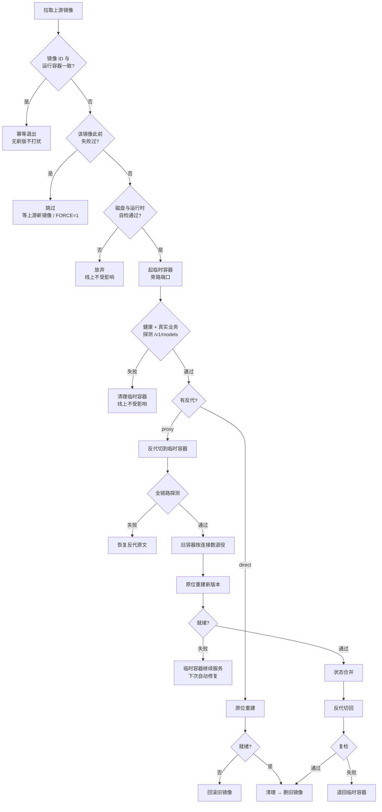

# magpie.sh

一个脚本管住 magpie 网关的升级与日常运维。

magpie（[yetone/magpie](https://github.com/yetone/magpie)）发版极频繁——实测一天十几次。
手动 `docker pull` + 重建容器会掐断正在跑的流式请求与长推理（实测 p99.9 = 303s、
最长 598s），被掐断的请求连用量都不写，等于静默失败。

本脚本把升级做成蓝绿切换：新版本先在旁路端口完整验证，通过后才接流量，
任何一步失败自动回退。**线上一句话：失败的那一侧永远不会接管流量。**

单文件、零配置起步、自带交互菜单。

## 红绿流程

绿 = 验证通过才前进；红 = 失败即回滚，线上由已验证的版本继续服务。



## 两种模式，自动判定

脚本会自己看容器是谁起的，你不用告诉它：

| | compose 模式 | docker 模式 |
|---|---|---|
| 判定 | 容器带 `com.docker.compose.*` 标签 | 无 compose 标签 |
| 重建方式 | `docker compose up -d --force-recreate` | 从运行容器 inspect 反推全部参数后 `docker run` |
| 你现有编排 | 零改动 | — |

两种模式都支持 `proxy`（有反代，零停机）和 `direct`（无反代，切换窗口 1–2 秒）。
`VHOST` 是否配置决定用哪个。

## 用法

```bash
curl -fsSLO https://raw.githubusercontent.com/kilvn/magpie-bluegreen/main/magpie.sh
chmod +x magpie.sh
sudo ./magpie.sh          # 交互菜单
```

菜单项：

```
1) 状态            当前版本 / 是否有待部署更新
2) 检查并升级      一次完整蓝绿流程（无新版则秒退）
3) 强制演练        FORCE=1，镜像未变也走一遍
4) 查看日志        最近 40 行
5) 清理对话        保留 N 天
6) 导出样例        nginx / 客户端接入片段
7) 编辑配置        /etc/magpie-upgrade.env
8) 安装定时任务    每 10 分钟升级 + 每天 04:35 清理
9) 卸载定时任务
```

也能直接从命令行调，适合 cron：

```bash
magpie.sh --status          # 状态快照
magpie.sh --upgrade         # 检查并升级（无新版秒退）
magpie.sh --retention 30    # 清理 30 天前的对话
magpie.sh --logs 100        # 最近 100 行日志
magpie.sh --export ./out    # 导出 nginx / 客户端样例
```

## 配置

三级优先级：**环境变量 > 配置文件 > 内置默认值**。
配置文件默认 `/etc/magpie-upgrade.env`（可用 `MAGPIE_CONFIG` 指定），菜单第 7 项可直接编辑。

大部分东西不用配：容器名、端口绑定、`/config` 数据目录、网络、启动命令
全部从运行中的容器自动探测。真正需要你决定的只有这几个：

| 变量 | 作用 | 默认 |
|---|---|---|
| `VHOST` | 反代 conf 路径。配了 = 零停机 proxy 模式 | 空（direct） |
| `PUBLIC_HOST` | 反代探活时的 Host 头 | 空 |
| `RUNTIME_DIR` | MCP 运行时目录（node/uv/git/pw）。空 = 跳过 | 空 |
| `DRAIN` | 退役最长等待秒数 | 700 |
| `GATEWAY_KEY` | 业务探测密钥。空 = 从 caller-keys.json 提取 | 空 |
| `KEEP_DAYS` | 对话保留天数 | 30 |

完整清单见 `magpie.sh --help`，或菜单第 6 项导出样例。

## 几个关键设计

**状态合并不做白名单。** 凡临时容器副本里比线上新的文件都并回（跳过锁/备份/版本
标记）。理由：上游新增状态文件时，固定清单跟不上，会把对话记录、掩码表整段丢掉。
JSON 先校验再原子替换，`providers.json` 额外校验供应商数量下限。

**追加型数据不复制、不合并。** 用量/路由/对话/脱敏/签名直接 bind mount 共享给
临时容器。两个进程对同一文件 `O_APPEND` 追加是原子的，既不会丢也不会重。

**同一个坏镜像不重复尝试。** 失败记忆 + 退避：同一镜像 30 分钟内不重建、累计
12 次后停止，等上游出新镜像自动解除。否则坏版本每 10 分钟白复制几百 MB 配置。

**退役等待按连接数自适应。** 每 5 秒采样退役容器上的 ESTABLISHED 连接数，
清空立即收尾，否则等满 `DRAIN`。固定 120 秒的旧做法会掐断长请求。

**合并点放在「重建之后、就绪之前」。** 此刻旧进程已停止（不会出现旧版本读到
新版本迁移过的配置），新容器仍在启动，来得及拿到临时容器刷新过的 token。

## 前置依赖

- bash 4+、curl、rsync、flock、docker；jq 推荐（无则退化为 grep 提取密钥、跳过 JSON 校验）
- 数据目录属主：官方镜像以 uid 65532 运行，否则容器报
  `mkdir /config/magpie: permission denied`——**健康检查不碰磁盘，状态仍显示 healthy**，
  别被误导
- proxy 模式：nginx / OpenResty（宿主机或容器内均可，前者配 `NGINX_CONTAINER` 为空即可）

## 常见问题

| 现象 | 原因 |
|---|---|
| 「等待锁超时」 | 上一轮还在升级（两次退役最长 2×DRAIN），本轮跳过，正常 |
| 「反代改写未生效」 | `proxy_pass` 不是 `http://<ip>:<port>;` 形式，检查反代写法 |
| 「运行时缺失」 | 配了 `RUNTIME_DIR` 但 node/uv/git/pw 缺件；不用资源库就留空 |
| direct 模式窗口内客户端报错 | 预期内，原位重建 1–2 秒。要零停机请配 `VHOST` |
| 升级后凭证丢失 | 看日志里「跳过合并」行，检查 `DATA_DIR` 是否指向正确的宿主机目录 |

## 部署指南（H5）

移动端友好的单页部署教程，可直接分享：

- [`docs/index.html`](docs/index.html) — docker-compose 从零部署（含反代流式要点、MCP 运行时、升级策略、排错）

本地预览：

```bash
open docs/index.html          # macOS
xdg-open docs/index.html      # Linux
```

开启 GitHub Pages（Settings → Pages → Source: `master` / `/docs`）即可获得可分享链接。

## License

[MIT](LICENSE)
